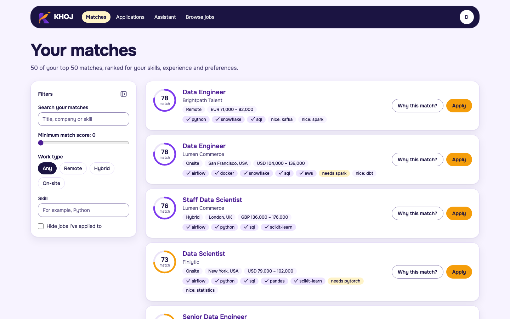
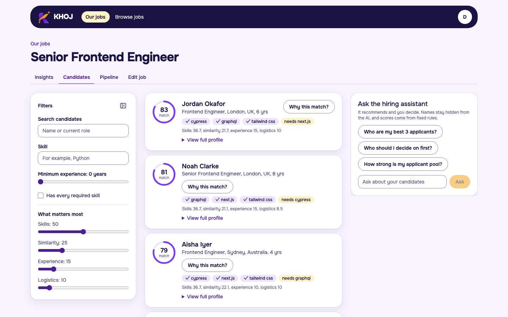
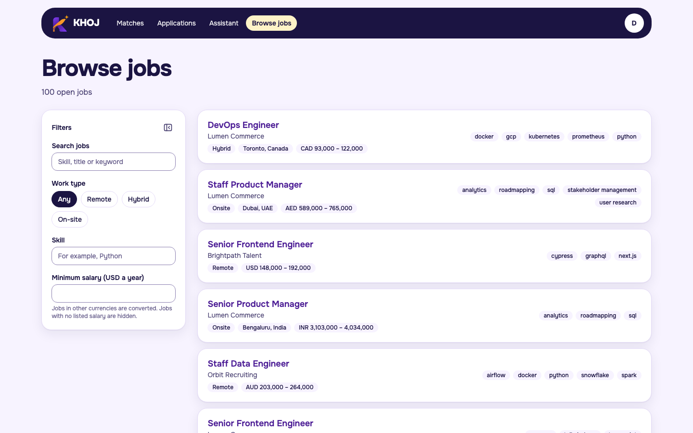
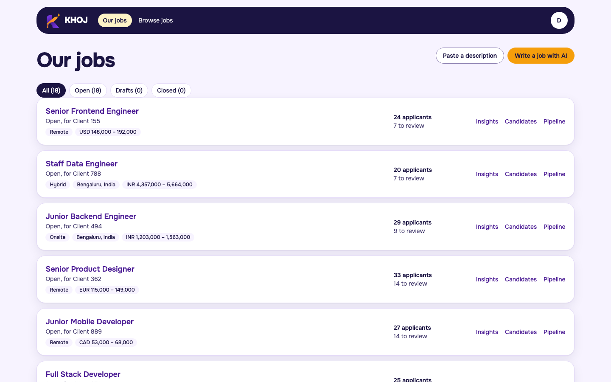
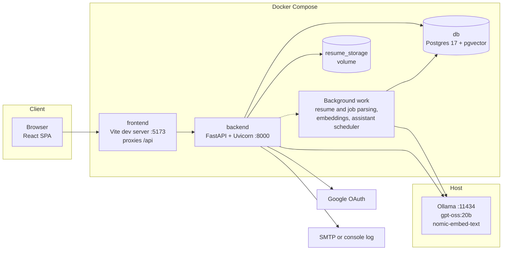
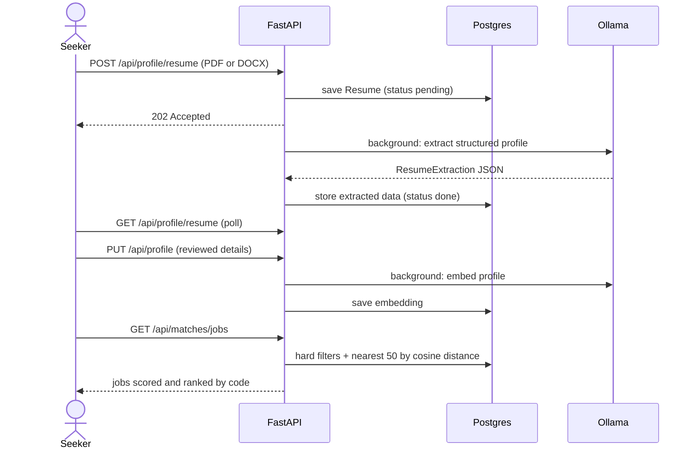
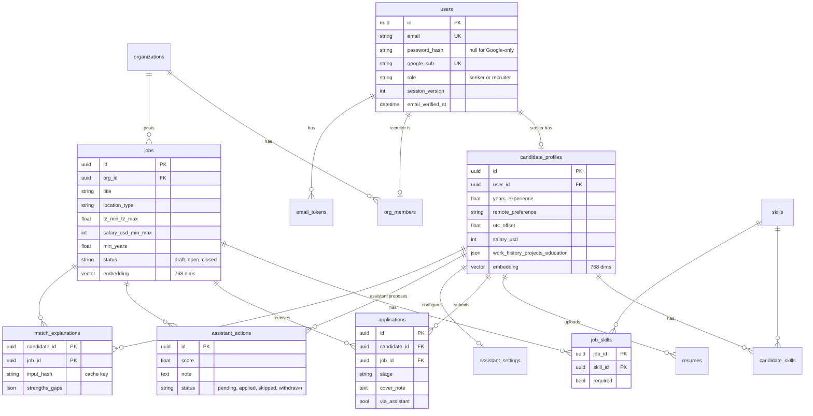
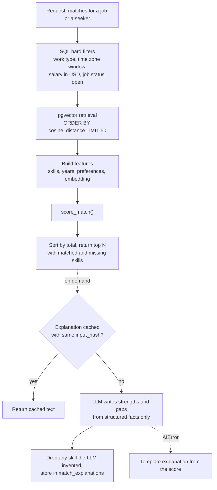

# Khoj

AI-assisted hiring: job seekers find the right jobs, recruiters and agencies find the right
candidates, and both sides see why a match was made.

**AI runs locally through [Ollama](https://ollama.com).** No API key is needed, and resumes never
leave your machine.


## Features

**For job seekers**
- Upload a PDF or DOCX resume and the AI fills in your profile for you to check
- Every job gets a match score out of 100, with the skills you have and the ones you're missing
- "Why this match?" explanations written on demand
- Filter by work type, skill, minimum score and salary, with salaries compared across currencies
- An optional application assistant that prepares or sends applications under rules you set

**For recruiters and agencies**
- Ranked candidates for each job, with adjustable weights for skills, similarity, experience and logistics
- A pipeline board across applied, screening, interview, offer, hired and rejected
- Insights per job: score spread, skill coverage and who has waited longest for a decision
- An AI job writer that turns a short brief into a full description and flags exclusionary wording
- A read-only hiring assistant chat that never sees candidate names

**Accounts**
- Email and password with confirmation and reset links, or Google sign-in
- Login rate limits stored in Postgres

## Screenshots

| Job seeker | Recruiter |
| --- | --- |
| **Matches** ranked by score, with skill gaps<br> | **Candidates** with adjustable weights and the hiring assistant<br> |
| **Browse jobs** with filters and currency-aware salary search<br> | **Insights**: applicants, score spread and who needs a decision<br> |
| **Application assistant** with rules and draft notes for review<br> | **Pipeline** across hiring stages<br> |
| | **Our jobs** list for a hiring team<br> |

Screenshots use the fictional seed data from `scripts/seed.py`.

## Tech stack

| Layer | Tools |
| --- | --- |
| Frontend | React 19, TypeScript, Vite, Tailwind CSS 4, TanStack Query, React Router, Recharts |
| Backend | Python, FastAPI, SQLAlchemy (async), Alembic, Pydantic, Argon2, PyJWT |
| Data | PostgreSQL 17 with pgvector |
| AI | Ollama: `gpt-oss:20b` for text, `nomic-embed-text` for embeddings |
| Tests | pytest, Playwright |
| Run | Docker Compose |

## High-level design (HLD)

### System architecture



| Component | Responsibility |
| --- | --- |
| **Frontend** | Single-page app with seeker and recruiter areas. Server state is cached by TanStack Query. All calls go to `/api`, which Vite proxies to the backend, so cookies stay same-origin. |
| **API** | Stateless FastAPI app. Eight routers: `auth`, `google_auth`, `profile`, `jobs`, `matches`, `applications`, `hiring_tools`, `assistant`. |
| **Background work** | Runs in the same process: FastAPI `BackgroundTasks` for resume parsing, job parsing and embeddings, plus an `asyncio` loop that runs the application assistant every 30 minutes. |
| **Postgres + pgvector** | All app data, 768-dimension embeddings for candidates and jobs, cached AI explanations and rate-limit events. |
| **File storage** | Uploaded resumes on a Docker volume, behind a `Storage` interface so it can move to object storage. |
| **Ollama** | Local LLM and embedding model, behind `LLMClient` and `EmbeddingClient` interfaces. A `fake` provider is used in tests. |

### Design principles

- **AI assists, code decides.** The LLM extracts data and writes text. Scores, filters, eligibility and pipeline moves are deterministic code.
- **Works without AI.** Search, scoring, insights and the pipeline still work when Ollama is down. Explanations fall back to a template, and resume upload falls back to manual entry.
- **Fairness by construction.** Names, age, gender, contact details and raw resume text never reach the scoring function or the hiring assistant.
- **Swappable providers.** Each external dependency (LLM, embeddings, storage, email) sits behind an interface chosen by an environment variable.

### Main flows

**Seeker:** sign up → upload resume → AI extracts details → seeker reviews and saves the profile → embedding is computed → ranked matches → apply directly, or through the assistant.

**Recruiter:** sign up → create an organization → write a job (by hand or with the AI writer) → publish → job is parsed and embedded → ranked candidates and applicants → move applicants through the pipeline, using insights and the hiring assistant.



## Low-level design (LLD)

### Data model



Salaries are stored in their original currency and as USD (`salary_usd*`), so filters compare across currencies with a single index-friendly comparison. Schema changes go through Alembic migrations in `backend/alembic/versions/`.

### Backend modules

| Module | Key pieces |
| --- | --- |
| `routers/` | HTTP layer only: validation with Pydantic schemas, auth dependencies, calls into services |
| `auth.py` | Argon2 password hashing, JWT session cookie, `current_user`, `current_seeker`, `current_recruiter`, `current_org` dependencies |
| `matching/scoring.py` | Pure functions: `score_match(CandidateFeatures, JobFeatures, Weights) -> ScoreBreakdown` |
| `matching/service.py` | `candidates_for_job`, `jobs_for_candidate` (SQL filters + pgvector retrieval + scoring), `explain_match` |
| `matching/analytics.py` | Insights per job: score histogram, skill coverage, "needs a decision" list |
| `ai/base.py` | `LLMClient` (`extract`, `chat`) and `EmbeddingClient` (`embed`) protocols, `AIError` hierarchy |
| `ai/factory.py` | Chooses Ollama or fake clients from settings |
| `ai/tasks.py` | Background jobs: `parse_resume`, `parse_job`, `refresh_candidate_embedding`, `refresh_job_embedding` |
| `ai/agent.py` | Hiring assistant: tool-calling loop over read-only `JobTools` |
| `assistant.py` | Application assistant: eligibility rules, note writing, `scheduler_loop` |
| `rate_limit.py`, `account_tokens.py`, `mailer.py` | Login limits, single-use email tokens, email delivery |

### API

| Area | Endpoints |
| --- | --- |
| Auth | `POST /auth/register`, `/auth/login`, `/auth/logout`, `/auth/forgot-password`, `/auth/reset-password`, `/auth/verify-email`, `/auth/resend-verification`, `GET /auth/me` |
| Google | `GET /auth/providers`, `/auth/google/start`, `/auth/google/callback`, `/auth/google/pending`, `POST /auth/google/complete` |
| Profile | `GET/PUT /profile`, `POST/GET /profile/resume`, `GET /profile/export`, `DELETE /account` |
| Jobs (public) | `GET /jobs`, `GET /jobs/{id}` |
| Jobs (recruiter) | `POST /organization`, `GET/POST /org/jobs`, `POST /org/jobs/draft`, `GET/PUT /org/jobs/{id}`, `PATCH /org/jobs/{id}/status` |
| Matching | `GET /matches/jobs`, `GET /matches/jobs/{id}/explanation`, `GET /org/jobs/{id}/matches`, `GET /org/jobs/{id}/candidates/{cid}/explanation` |
| Applications | `POST/GET /applications`, `GET /org/jobs/{id}/applications`, `PATCH /org/applications/{id}` |
| Hiring tools | `POST /org/jobs/generate-description`, `POST /org/jobs/check-description`, `GET /org/jobs/{id}/analytics`, `POST /org/jobs/{id}/agent` (NDJSON stream) |
| Assistant | `GET /assistant`, `PUT /assistant/settings`, `POST /assistant/run`, `POST /assistant/actions/{id}/approve`, `/skip`, `/withdraw` |
| Health | `GET /health` (database and Ollama status) |

All paths are under `/api`.

### Matching pipeline



Score components (default weights, which recruiters can change per search and are normalized to 100):

| Part | Weight | Calculation |
| --- | --- | --- |
| Skills | 50 | 80% share of required skills held + 20% share of nice-to-have skills |
| Similarity | 25 | Cosine similarity, rescaled from the 0.65 to 0.88 band to 0 to 1 |
| Experience | 15 | `min(1, candidate years / job minimum years)`, 0.5 if unknown |
| Logistics | 10 | Work mode match (0.5, or 0.35 if different) + time zone in window (0.25) + salary within budget (0.25) |

### Hiring assistant (agent)

- The recruiter's chat history goes to the LLM with four tools: `find_candidates`, `list_applicants`, `compare_candidates` and `pool_summary`.
- Tools return anonymous references such as `C-1a2b3c`, numbers and skill names, never names or text written by candidates. Names are put back into the final answer for the recruiter only.
- The run uses its own database session started with `SET TRANSACTION READ ONLY`, so Postgres rejects any write.
- At most 5 tool rounds, then a final answer. Progress and the answer stream to the browser as NDJSON events (`status`, `answer`, `error`).

### Application assistant

1. Triggered by `POST /assistant/run` or by `scheduler_loop` every `ASSISTANT_INTERVAL_SECONDS`.
2. Takes a Postgres advisory lock per candidate, so overlapping runs can't exceed the daily limit.
3. Counts actions in the last 24 hours and pending reviews to find how many slots remain.
4. Ranks jobs with the normal matching pipeline, skipping jobs already applied to.
5. `is_eligible` checks minimum score, required skills, excluded companies and at least half of the job's minimum years.
6. The LLM writes a short note from structured facts, without the seeker's name or contact details.
7. In `ask` mode an `AssistantAction` waits for approval. In `auto` mode (needs recorded consent) an `Application` is created with `via_assistant = true`.

### Security

| Concern | Approach |
| --- | --- |
| Passwords | Argon2 hashes |
| Sessions | HS256 JWT in an HttpOnly, SameSite=Lax cookie, valid 7 days. It carries `session_version`, which is incremented on password reset to sign out every device. |
| Email links | Random tokens, stored as SHA-256 hashes, single use. Confirmation lasts 48 hours and reset 1 hour. |
| Brute force | Limits per email + IP, per email and per IP, stored in `rate_limit_events` |
| Access control | Role dependencies on every route. Recruiters only see jobs owned by their organization. |
| Uploads | 5 MB limit, file type detected from content, not the file name |
| AI safety | AI output is validated against Pydantic schemas. Unknown skills are dropped. The agent is read-only at the database level. |

## How matching works

The LLM reads documents and writes explanations, but **it never sets a score**. Ranking is
deterministic code in `backend/app/matching/scoring.py`:

1. **Hard filters:** work type, time zone window, salary compared across currencies.
2. **Retrieval:** top 50 by embedding similarity.
3. **Score out of 100:** skills 50, similarity 25, experience 15, logistics 10. Recruiters can
   change the weights per search.
4. **Explanation:** written on demand and stored. If AI is unavailable, a summary is built directly
   from the score.

Names, age, gender and raw resume text are not inputs to the score.

## Hiring partner tools

- **AI job writer** (`/recruiter/jobs/new`): turns a short brief into a full description, revises it on request, flags exclusionary wording, missing required skills and experience figures that aren't in the brief. Client names are never sent to the AI.
- **Hiring assistant** (chat on each job's Candidates page): answers questions using read-only tools. It sees anonymous references, numbers and the job's own skills, never names or text written by candidates. Postgres enforces read-only access for the whole run, and a recruiter makes every pipeline move.
- **Insights** (`/recruiter/jobs/:id/insights`): match score spread, skill coverage, top candidate comparison and a "needs a decision" list. These are computed by code, so they work without AI.

Discovered candidates with under half of a job's minimum years are hidden. Anyone who applied stays visible.

## Application assistant

Job seekers can turn on an assistant at `/assistant`. It's off by default and applies only to jobs on Khoj. In "ask me first" mode, it prepares applications for review. In "apply automatically" mode, which needs explicit permission, it submits them, and it re-checks every 30 minutes (`ASSISTANT_INTERVAL_SECONDS`) while the backend runs.

Fixed rules choose jobs: minimum score, daily limit (10 at most), excluded companies and required skills. AI only writes the cover note, from structured facts, without the applicant's name, contact details or the job posting's text. Employers can see which applications came through the assistant, and seekers can withdraw one until the employer moves it forward.

## Brand

Brand colours and fonts live in `frontend/src/index.css`, so components only use names like `bg-canvas` and `text-brand`. Chart colours are checked for colourblind readability.

## Accounts and email

New accounts get a link to confirm their email, and anyone can reset a forgotten password by email. Links work once and only their hash is stored. Confirmation links last 48 hours and reset links last 1 hour. A password reset signs the user out on every device. Until they confirm, accounts see a reminder and can browse and fill in their profile, but can't apply to jobs, publish a job or use the assistant.

Failed logins are limited to 5 per 15 minutes for each email and IP address, with looser limits per email and per IP. Sign-ups and email sends are limited too. Limits are stored in Postgres, so they hold across restarts and server processes.

In development, `EMAIL_PROVIDER=console` prints each email to the backend log, so run `docker compose logs backend` to find a link. For real delivery set `EMAIL_PROVIDER=smtp`, the `SMTP_*` values and `APP_BASE_URL`. Behind a reverse proxy, set `TRUSTED_PROXY_COUNT`, or every visitor shares the proxy's IP address.

### Google sign-in

The "Continue with Google" button appears once `GOOGLE_CLIENT_ID` and `GOOGLE_CLIENT_SECRET` are set. Create them in the [Google Cloud console](https://console.cloud.google.com/apis/credentials) as an OAuth client of type "Web application", and add this authorized redirect URI, using your own `APP_BASE_URL` in production:

```
http://localhost:5173/api/auth/google/callback
```

Sign-in asks Google for the person's email, name and photo. The name starts a job seeker's profile, where they can change it, and the photo only appears in their own account menu. New Google users choose their role and accept the data consent on a short page before an account is created. A Google login joins an existing account with the same email. If that email was never confirmed, its password is removed and its sessions end, so nobody who pre-registered someone else's address keeps access.

## Run it

Requires Docker and Ollama running on the host.

```bash
ollama pull gpt-oss:20b
ollama pull nomic-embed-text
docker compose up -d --build
docker compose exec backend python -m scripts.seed   # 200 fictional candidates, 100 jobs
```

Open http://localhost:5173 and use the demo buttons on the login page. Browsing, search and scoring
work without Ollama. Resume reading and AI explanations need it. `gpt-oss:20b` uses about 13 GB of
memory; choose a smaller model with `LLM_MODEL` in `.env`.

To change settings, copy `.env.example` to `.env`. Every value has a working development default.

## Project layout

```
backend/
  app/
    ai/          LLM and embedding clients, prompts, the hiring assistant agent
    matching/    scoring, retrieval and recruiter analytics
    routers/     API endpoints: auth, jobs, matches, applications, profile, assistant
    models/      SQLAlchemy tables
  alembic/       database migrations
  scripts/       seed data, re-embedding, model comparison
  tests/
frontend/
  src/
    pages/       seeker, recruiter, hiring tools, assistant, account
    components/  shared UI, charts, chat
    api/         typed API client
  e2e/           Playwright tests
docs/screenshots/
```

## Using a hosted AI API later

Everything provider-specific lives in `backend/app/ai/`:

1. Add a class implementing `LLMClient` from `base.py`.
2. Add a branch for it in `factory.py`.
3. Add it to `CLIENTS` in `tests/test_llm_contract.py`, then set `LLM_PROVIDER` and `LLM_MODEL`.

Embeddings are configured separately, because not every LLM provider offers them. After changing
`EMBEDDING_MODEL`, run `python -m scripts.reembed` and recalibrate the similarity band in
`scoring.py`. The vector column is 768 dimensions, so a model of another size also needs a migration.

## Tests

```bash
docker compose exec backend pytest                     # unit and API tests, fake AI
docker compose exec -e OLLAMA_TEST_URL=http://host.docker.internal:11434 backend pytest  # adds real Ollama
cd frontend && npm install && npx playwright install chromium && npm run e2e   # browser, live stack
python -m scripts.compare_models gpt-oss:20b llama3.2  # from backend/, compare models
```

## Before real-world use

This is a portfolio project. Salary conversion uses static rates in `app/fx.py`, and `JWT_SECRET`
and `COOKIE_SECURE` must be set for any deployment. Automated hiring tools are regulated in several regions, including
under the EU AI Act and New York City Local Law 144, so get legal advice before using this on real
candidates.
